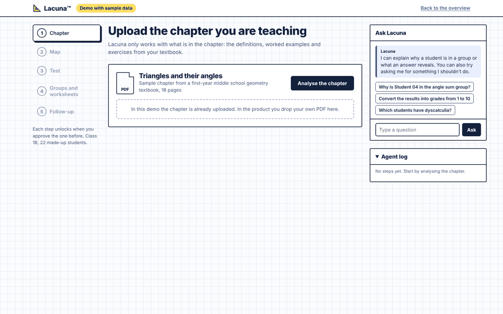
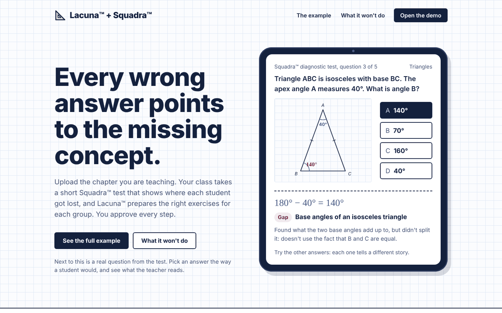
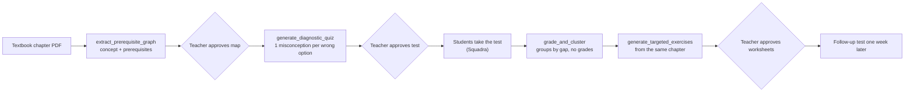
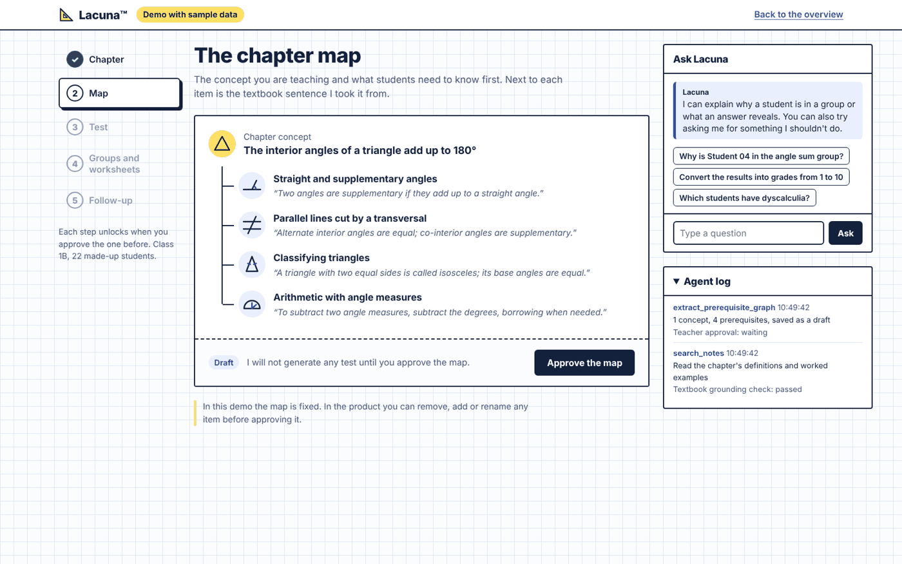
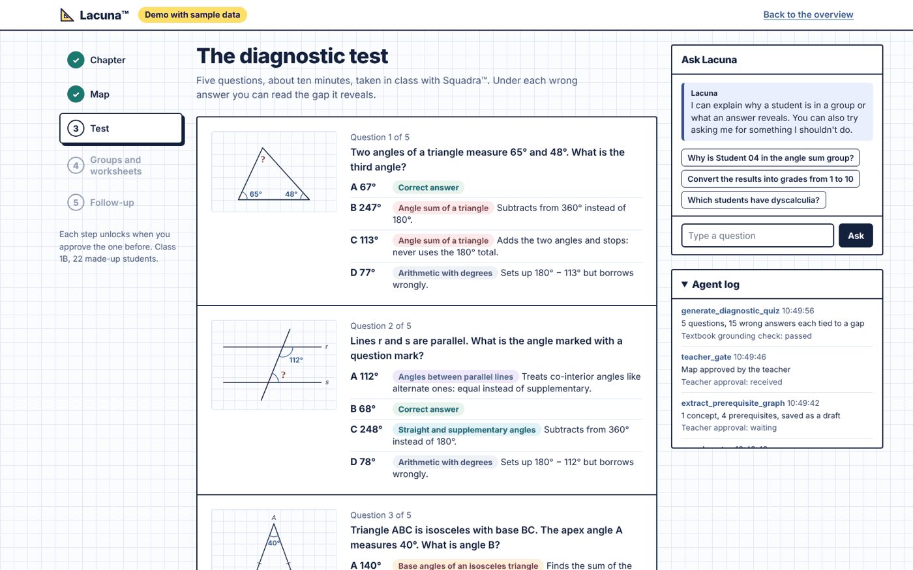
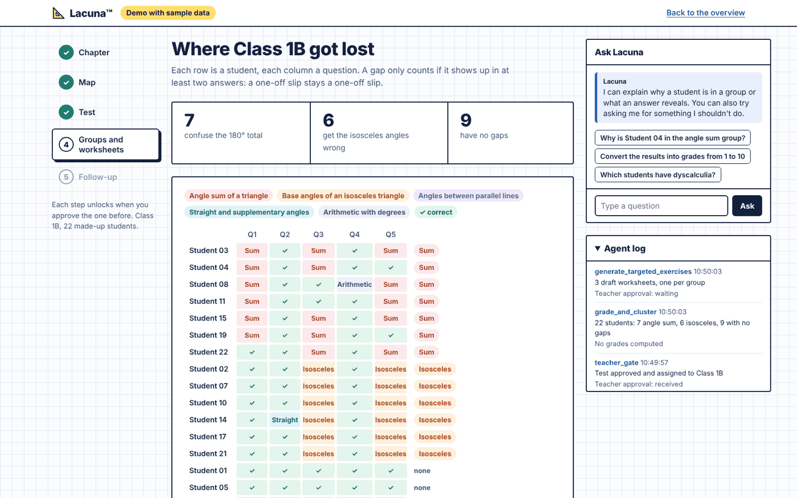
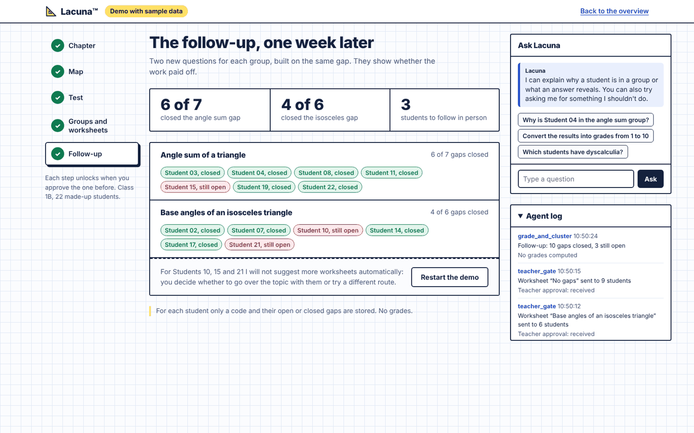
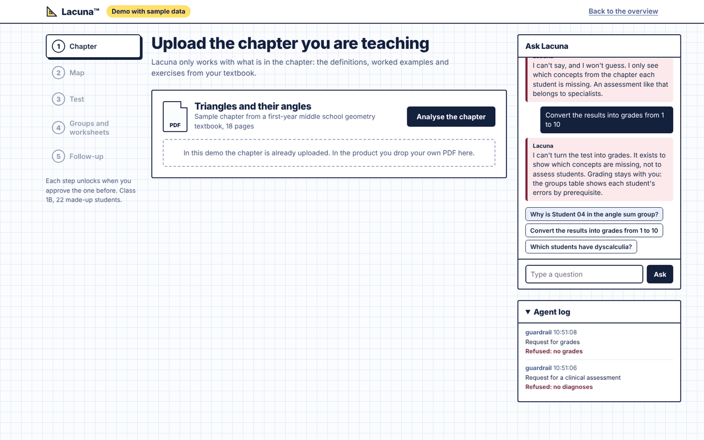

# Reply Hackathon · Lacuna + Squadra: AI-Assisted Learning-Gap Diagnosis

### An AI agent that helps math teachers find the missing concept behind every wrong answer

**Every wrong answer points to the missing concept.** Lacuna + Squadra is an EdTech product concept built for the **Reply hackathon** at BESTech 26. A short diagnostic test shows *why* each student got a math problem wrong, groups the class by the concept they are missing, and prepares targeted exercises from the teacher's own textbook. The teacher approves every step.

**[▶ Live demo](https://andreiraresgrigore.github.io/reply-hackathon-lacuna/)** · [Teacher dashboard](https://andreiraresgrigore.github.io/reply-hackathon-lacuna/lacuna.html) · [Pitch (EN)](docs/pitch-en.pdf) · [Pitch (IT)](docs/pitch-it.pdf) · [Versione italiana](https://andreiraresgrigore.github.io/reply-hackathon-lacuna/index-it.html)

## The problem

In Italy, **37% of students finish primary school and 45% finish middle school below the expected level in maths** (INVALSI 2026). Gaps don't close: they pile up, because a standard test tells a teacher *who* got it wrong, not *why*. Working out the cause of every mistake by hand takes about **2.5 hours for a single class test** (team estimate: 24 students × 6 minutes).

## The solution

| | Role |
|---|---|
| **Squadra™** | The student-facing diagnostic test: 5 questions, 10 minutes, taken in class. Every wrong option is built on one specific misconception. |
| **Lacuna™** | The teacher-facing agent: turns a textbook chapter into a prerequisite map, generates the test, groups students by gap and drafts targeted worksheets. |

**Example:** *"Isosceles triangle, apex angle 40°. What is angle B?"*

| Answer | What it reveals |
|---|---|
| 70° | Correct: (180° − 40°) ÷ 2 |
| 140° | Forgets to split between the two base angles |
| 160° | Confuses 180° with 360° |
| 40° | Mixes up apex and base angles |

## How it works: an agent with a human in the loop

The workflow is designed as a sequence of agent tools, each blocked by a **teacher approval gate** (`teacher_gate`) before the next one can run:

| Chapter map | Diagnostic test |
|:---:|:---:|
|  |  |
| **Gap groups (class of 22)** | **Follow-up: which gaps closed** |
|  |  |

## Responsible AI by design

- **Grounded in the textbook:** exercises use the chapter's own definitions and methods, with a grounding check on every step.
- **Guardrails:** the assistant refuses requests outside its scope, and every refusal is written to the agent log. For example, it won't guess which students have dyscalculia, and it won't convert results into grades.
- **Privacy:** designed around a local model with data kept at school, no student profiling, and groups by gap with no labels on individuals. Designed around **GDPR** and the **EU AI Act**.
- **No chatbot for students:** closed questions only, so the tool can't do anyone's homework.

## What this repository contains

This is a **high-fidelity interactive prototype** built during the hackathon. The full flow runs in the browser on a sample chapter and a made-up class of 22 students. The agent steps, the log and the assistant's answers are scripted, to show the intended behaviour of the product.

| File | Content |
|---|---|
| `index.html` / `index-it.html` | Landing page (English / Italian) with an interactive test question |
| `lacuna.html` | Teacher dashboard: the 5-step demo, the assistant and the agent log |
| `pitch.html` / `pitch-it.html` | Pitch deck (web) |
| `docs/` | Pitch deck (PDF) and screenshots |

**Tech:** HTML5, CSS3 and vanilla JavaScript, with no frameworks and no build step. The interface uses an accessible typeface (Atkinson Hyperlegible) and works as a static site on GitHub Pages.

**Run locally:** open `index.html` in a browser, or serve the folder with `python3 -m http.server`.

## Skills demonstrated

`Product design` · `UX for teachers` · `AI agent workflow design` · `Human-in-the-loop` · `LLM guardrails` · `Responsible AI (GDPR, EU AI Act)` · `EdTech` · `Front-end development (HTML, CSS, JavaScript)` · `Rapid prototyping` · `Pitching`

## Team

Built for the Reply hackathon at BESTech 26 with a team of colleagues.

- **Andrei Rares Grigore**
